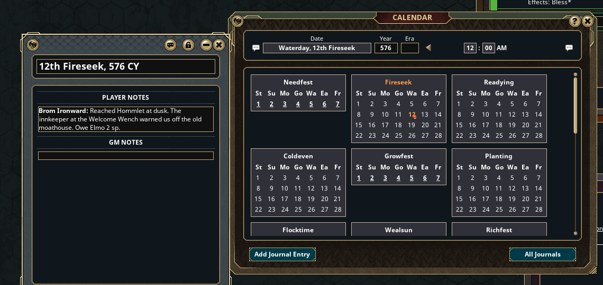

# Kraken Calendar Notes

Players can add notes to the in-game calendar: double-click a day (the base rulesets let only the GM). The GM's table makes the note in the shared Adventure Log, stamped with the player's name and colour, and gives the player ownership so they can write in it (double-click the day again to open it). One note a day, as in Fantasy Grounds itself.

Built into Kraken35E and SiegeCore; this extension is for AD&D 2E, official C&C, Traveller and plain 3.5E / Pathfinder 1E.

## Install

Copy the `KrakenCalendarNotes` folder into your Fantasy Grounds `extensions` folder and tick
**Kraken Calendar Notes** in a AD&D 2E, official C&C, Traveller, 3.5E or PFRPG campaign.

## Changelog

## 0.2 (2026-10-23)

- One extension for every ruleset that lacks it (was 3.5E / PFRPG only, `KrakenCalendarNotes35E.ext`).
- The player who makes a note owns it, so they can type in it.

## 0.1

- Player-created notes with author and colour stamps (3.5E).
